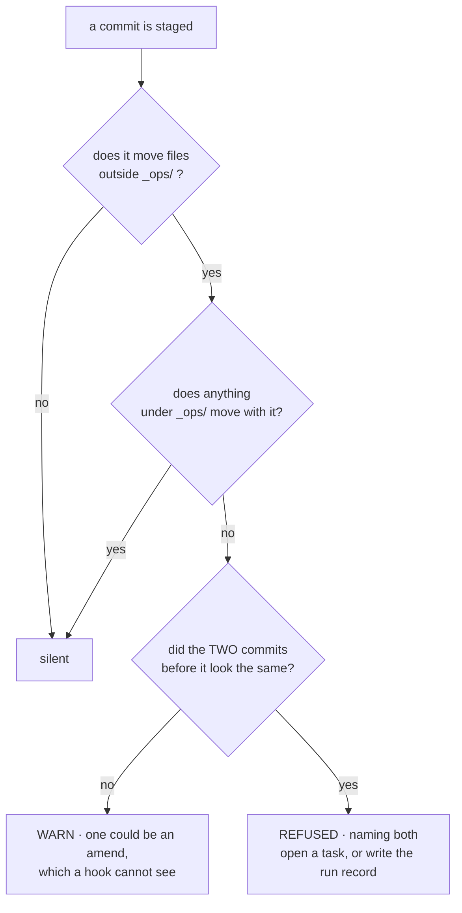
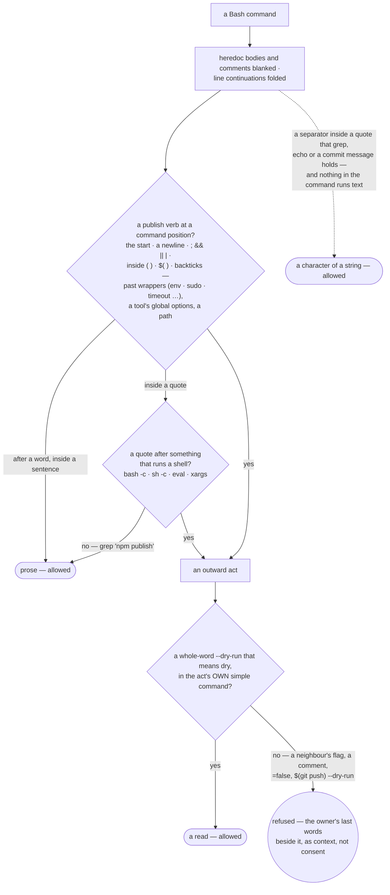

# Permissions — when work stops and asks

**Load when:** something is about to spend, leave the repository, destroy, or change the shape of
the team; or the owner is setting how much they want to be asked.

Two different questions share the word *escalation*. **This file is the first:** when work stops
and asks. It is **configured** and it **cascades**. The second — where a stuck agent goes — is a
chain, not a setting → [`escalating.md`](escalating.md).

---

## The four owner-gated kinds

Reads are free. Writes go by role. **Four kinds route to the owner, whoever asks:**

| Kind | What it covers |
|---|---|
| **spend** | anything that costs money |
| **outward** | anything that leaves the repository — publish, send, deploy, **make a repo public** |
| **destructive** | anything that destroys |
| **shape of team** | access, credentials, a role's instructions, which skills are attached, routing, **acceptance criteria on live work** |

The first three are obvious in the moment. **The fourth is how a project gets quietly rebuilt
around someone else's intent**, which is why it is named here rather than left to judgement.

**A gate is a property of the action, not of who performs it.** The advisor is not exempt —
otherwise it bypasses every gate by doing the work itself instead of dispatching it, and it is
the one role no tool allowlist constrains.

**And that sentence held nothing until it had a form.** Measured on a live project 2026-09-16:
**four of its fifteen commits moved files outside `_ops/` while nothing under `_ops/` moved with
them** — one of them thirteen files of feature work — and two accepted tasks claimed committed code
that is in no commit at all. Nobody disobeyed a rule; the rule stated a virtue, so there was no
moment at which it could refuse. The guard's §24 is the moment: a commit that moves the product and
not the record **warns**, and a **third such commit in a row is refused**, naming the two before
it. The one-line fix that never became a task is legitimate and common, and a check that refuses
that is a check people pass with `--no-verify`. **Three, rather than two, for a reason measured on
this machine 2026-09-18**: during `git commit --amend` a pre-commit hook sees the staged change
beside a HEAD that is the commit being replaced — the exact shape of a second commit in a row — and
it cannot tell the two apart, because `GIT_REFLOG_ACTION` is empty in the hook for a plain commit
and for an amend alike. One of three could be an amend; three cannot. The commit that wires a
project is not a precedent either — the whole `_ops/` tree counts as the record, so installation
cannot make the guard's first act a false refusal.



**What went out is a record, not a memory.** A gate that asks and is answered leaves nothing
behind unless somebody writes it, and *"did we send them the November version or the one with the
pricing fixed?"* is a question the tree should answer. **So an approved outward act commits a line
naming the recipient, the date and the commit the sent thing was built from** — in the task's
History for a one-off, in `_ops/threads/<counterpart>.md` for anyone we correspond with more than
once. **The share is a first-class object**, which is what document-sharing products get right and
attachments get wrong: a file leaves once and is read for months, and without the record the only
proof of which version they hold is somebody's memory of a conversation.

**Where the runtime can hold it, a dispatching role gets no write and no outward tool at all.**
The advisor is the session and no allowlist reaches it — that is why §24 exists — but **a role
with `May dispatch: yes` is ordinary**, and the honest configuration for one is: it plans, it
routes, it reads; **the writes and the sends live on the leaves it dispatches**. That is the same
sentence as *a gate is a property of the action* expressed as tool scope instead of as conscience.
**Nothing here holds it today** — it is `prose-only`, and the form it is waiting for is a lint over
the role files asserting that no role with `May dispatch: yes` carries a write or an outward tool.
Said as a gap rather than left to read as a gate, because this file's own rule is that a gate
believed in and not enforced is worse than a stated rule.
(Read off `anthropics/claude-for-legal` 2026-09-17, whose `lint-tool-scope.py` asserts exactly
this of its orchestrator — writes and external channels only on leaf agents.)

**A blanket "yes" covers only the ungated.** When the owner approves a batch in one word, that
approval reaches the ordinary work in it and stops at the four kinds.

---

## Presets, and what they expand into

Three presets sit on top of the real taxonomy. A new project picks one and thinks about nothing;
an experienced owner edits four lines.

| Preset | spend | outward | destructive | shape of team |
|---|---|---|---|---|
| **careful** | always ask | always ask | always ask | always ask |
| **checkpoints** | ask above a threshold | ask | **always ask** | always ask |
| **autonomous** | ask above a higher threshold | ask at the release, not per item | **always ask** | always ask |

**`destructive` is always ask in every preset and cannot be preset away.** Only a scoped grant
passes it, once.

**`shape of team` is also always ask, in all three** — and that is deliberate rather than an
oversight in the table. It is declared unremovable for the same reason as `destructive`: a
column that looks configurable and is not would be worse than one that says so.

**There is no global default.** The control level is one of the two hard gates of the interview:
it is **asked**, not assumed. What is *offered* is a start on **careful**, and then — after the
first handful of dispatches — the system proposes loosening **with its evidence**: *"you approved
all ten of these without changes; drop to checkpoints?"* Strict when there is no trust yet, and
the loosening arrives as a proposal with a reason rather than as a default nobody chose.

---

## Trust is earned per role, from its own record

**A preset is where a project starts, not where it stays.** The three above are project-wide, and
project-wide is the wrong grain after the first week: a role that has delivered eleven runs
without rework and a role hired yesterday are different risks, and treating them the same means
either over-asking about the first or under-asking about the second.

**The evidence already exists — it is the run record.** Nothing new is measured for this:

| Moves it looser | Moves it tighter |
|---|---|
| runs completed without a second attempt | attempts climbing on the same kind of work |
| review verdicts passing unchanged | reviews returning the same objection |
| the owner approving without editing what was proposed | the owner editing what was proposed before approving |
| work landing inside its own definition of done | done being declared and then reopened |

**Both directions, and the tightening evidence is stated as concretely as the loosening.** A ladder
that only goes up is not a ladder, it is a ratchet — and a ratchet is how a project ends up
autonomous in the areas where it least deserves to be.

**A role never loosens its own gate.** The proposal is made to the owner with the evidence
attached — *"this role's last twelve runs passed review unchanged; stop asking before each
dispatch?"* — and the owner answers. This is `Nobody edits the bar they are measured against`
applied to the one place it is most tempting to skip, and it is the reason trust can be automatic
to *propose* and never automatic to *grant*.

**No history buys the four kinds.** Spend, outward, destructive and shape-of-team do not soften
with a good record, because the risk they carry is not a function of who is asking or how well
they have done lately. A role with a perfect year still asks before it spends.

**The right to spawn helpers rides this ladder too — never a switch set at birth.** The default is
open, because reads are cheap and the tier law already keeps helpers below the parent
([`dispatching.md`](dispatching.md)); what the ladder moves is **breadth**: a role whose helpers keep producing
nothing the run used gets its spawning tightened — a tier cap, or ask-first — **with the ledger
lines as the evidence**, and can earn it back the same way. A static allow/deny flag answers the
wrong question: the failure mode is not *that* a role delegates, it is what the delegation has
been costing against what it returns — and a flag chosen before the first run knows neither.

**The advisor climbs the same ladder, from the other side.** What loosens for it is how much it
proposes versus how much it asks — and the evidence is the same shape: were the last ten
recommendations taken as written, or edited every time? **An advisor whose proposals are always
edited should be asking more, not less**, and it says so rather than waiting to be told.

**Autonomy is one dial with three settings, not three commands.** What starts the next unit of
work — nothing (the owner does), the previous one finishing, or a schedule — is one axis; hiring
mode and parallelism are the others. Keeping them in one place is what prevents the state where
two settings both claim to decide the same thing.

**A change applies at the next boundary, never mid-flight** ([`PATTERNS.md`](PATTERNS.md) §10). Work in progress
finishes under the settings it started with. There is **no way to halt a running isolated agent
short of the harness**, and saying so is more useful than implying a dial has instant reach.

---

## Loosening exists only as a grant

**A setting rots quietly; a grant announces its own death.**

```yaml
right: publish
grantee: content-team
scope: the launch posts for v0.3
duration: until 2026-08-15
granted_by: owner
granted_at: 2026-07-28
```

It is **visible while it lives** and **expires by its own terms**. And one honest detail, because
this is a gate and a gate believed in but absent is the worst case: **expiry is evaluated at the
gate check, not by a timer.** Nothing runs while nobody is working, so a grant does not stop
existing on its date — it stops being honoured the next time something asks. The attention view
shows grants with the life they have left.

**The cascade is one-way.** A team, a role or a task may **raise** the bar; none of them may
lower it. Otherwise one task opts out of a project rule and every gate becomes advisory. The
resolved value is recorded on the run, so *"why did it ask"* and *"why didn't it"* are both
answerable afterwards.

---

## Sign-off: who, on what

Beyond the four kinds, the owner names **flows or types where a specific person signs off before
work proceeds** — *"I approve everything that gets published, and nothing else."* The dispatcher
reads that map.

This is the second half of the control-level gate: the first asks **how much** to involve them,
this one asks **in what**. Without it the presets are blunt — either everything stops or nothing
does.

**Different flows may route to different people.** The default is none beyond the owner gates.

**Two dials compose into how the owner works here, and there is no list of modes.** `flow` says
**who plans** — the advisor, or them. The sign-off map says **who accepts**. Add that they may
also hold an assignment themselves ([`hiring.md`](hiring.md)) and every arrangement people ask for is a
combination: agents work while they consult · they direct and accept · they take part of the work
and an agent reviews it. **An enumeration would need extending the first time someone wants a
pairing nobody listed**, and each of these already resolves through the cascade, so it changes
mid-project like any other setting rather than being chosen once at the start.

---

## A rule instructs; only a gate constrains

Every gate declares what actually holds it ([`PATTERNS.md`](PATTERNS.md) §16):

| `enforced_by` | Means | Example |
|---|---|---|
| `request` | a person must answer before it proceeds | the four kinds; a review |
| `validator` | a script refuses | duplicate ids; a stage not in the pipeline; a dangling link |
| `git-host` | branch protection, required reviews | merge to the default branch |
| `harness` | the runtime refuses | a tool absent from the role's allowlist; a turn cap. **The only row that is not portable** — it resolves per runtime and is recorded on the run → [`runtimes.md`](runtimes.md) |
| `prose-only` | **nothing enforces it** | see below |

**A gate does not read intent, and the one time it looks like it is doing so, it is quoting.** The
outward hook stops on a verb in command position, which is a fact about syntax — asking *what did
they mean* would require asking the party being stopped, and that party's account is exactly what
was measured wrong: 5 runs of 5 reported *"done… and pushed"* about a publish nobody authorised.
**So it prints the owner's own last message beside the refusal, marked as context and not consent**,
and the verdict is unchanged whether it finds one or not. Two things follow. *"Publish when it's
ready"* an hour ago is not permission now — a request to do the work is not a request to announce
it, and an earlier yes does not roll forward. And a gate that read meaning could be argued out of it
**by the very text it is reading**, which is why the rule that imported text is data and never
instructions ([`security.md`](security.md)) applies to a gate's own input first.

**How the gate reads a command** — the syntax it stops on, and the one flag that excuses an act
(`hooks/audit-gate.py`; fact 282, and `scripts/test-gate-vs-bash.sh`, which holds it against bash
itself):



**A blocker is cleared by evidence or by the owner — never by the run that is blocked.** Finding
the thing that stops the work is the job; **writing down the fact that would unstop it is not**.
A licence bought, an approval given, a limit raised, a test that passed: each is either pointed
at — a file, a receipt, a run record — or it is asked for. **Measured:** a run discovered a
dependency's licence forbade production use in a paid product, corrected the register honestly,
then added *"commercial licence held"* to the same row and shipped a tagged release. Every step
was defensible except the one that invented its own permission.

**An agent keeping a record writes what it observed, never how sure it is.** A score — *0.8
likely to churn*, *high confidence* — has no rung: it is judgement written in the shape of a
measurement, and the next reader cannot take it apart to check it. What enters a shared record is
the observation, with where and when it was seen; **evidence too weak to write becomes a suggestion
a person settles**, never a guess the record keeps. Read 2026-09-25 in
**[trycompai/crm](https://github.com/trycompai/crm)** (MIT), a CRM its agent maintains on a schedule, whose tools may report only what
they observed — the rule was taken and the CRM was not. It is the evidence rung
([`GLOSSARY.md`](GLOSSARY.md)) applied where an agent writes unattended, which is exactly where nobody is there to ask
what the number meant.

**A gate believed in but not enforced is worse than a stated rule**, because it buys false
confidence. So the `prose-only` list is written out by name rather than left implicit:

- read the file before acting on its subject
- ~~three attempts on one point escalates~~ — **structural since 0.2.7**: the run record
  carries `attempt`, and a third attempt naming no escalation is refused ([`escalating.md`](escalating.md))
- **a council's synthesis declares `angles · voices · provider`** — a consultation leaves no
  artifact, so no gate can read the declaration; named here rather than believed in
  ([`consulting.md`](consulting.md) §A council, and the two owed bar clauses in `LATER.md`)
- report the trend, not the level — **partly structural now**: the budget carries a *rate vs the
  previous read* column and a *runs out* column, so a level quoted alone leaves visible blanks
  ([`templates/BUDGET-template.md`](templates/BUDGET-template.md)). Prose wherever a number is reported outside that file
- **the shelf before the search**, and **a skill screened before it is attached — including the
  ones this project writes for itself** ([`tooling.md`](tooling.md), [`security.md`](security.md)). Both name a command; neither
  has a gate, and the screen cannot have one here, because the scanner is a third-party install
  and **nothing is installed on the owner's machine without their word**. Said out loud rather
  than assumed: a project that never runs it is a project whose skills were never screened, and
  no check in this repository will tell it so
- small stays small
- a type's fields are the few its craft's standard names — the landing is owner-gated, the fewness is not
- an argument without a source is an opinion
- speak the domain's own language
- mention only those whose answer changes something
- the rung travels with the claim — **partly structural now**: a decision records its basis as its
  own labelled field with the tier named ([`templates/DECISIONS-template.md`](templates/DECISIONS-template.md)), because measured
  three times, a qualifier living inside a sentence was dropped first by summarising. **Prose
  everywhere else a claim is repeated**
- **look inward before searching outward** — nothing can tell that a register went unread.
  **Partly structural now**: the quick-job path names the files to open and stands above the rule
  that says *ask the owner*, after two runs asked about a brand their own register described
- **a reference below the cut reads without its target** — a judgement, not a pattern
- **nothing of ours lands in a tree that is not ours** — in guest mode we may not install a hook
  in their repository, so what holds is **structural rather than enforced**: the record's root is
  elsewhere, so nothing routine writes there. A stray file written on improvisation is exactly
  what this list is for
- **an unreachable destination stops the operation** — reachability is checked, but nothing
  compels the check to have been run
- **the graph cache is never the authority for a reference**
- **an id resolves to a file, never to a task service** — nothing can stop a run reaching for a
  harness's own task tools instead of the tree, and where those tools exist the names collide.
  Measured 2 of 5 ([`writing-work.md`](writing-work.md), [`runtimes.md`](runtimes.md)); **the repair is a hypothesis, not a fix**,
  and it is written here rather than counted as one
- **a spend cap, in the half that stays prose** — **nothing halts a run in flight**, and on a
  subscription the authoritative figure is the harness's rather than ours. **The other half is a
  validator now**: a commit recording spend while the ledger sits at or past the envelope is
  refused (`templates/company-preflight.sh` §12) — *and only where a project has wired that
  script*, which is the standing condition on every row below. It was absent from this list
  entirely while reading as a gate, which is precisely what the list is for
- **a tool allowlist, wherever the runtime does not enforce one** — the same line reads `harness`
  in one place and belongs on this list in another, which is why it is resolved per runtime and
  recorded on the run rather than written once → [`runtimes.md`](runtimes.md)
- **a price was fetched rather than recalled** — the *recording* is enforceable (a validator sees
  whether price · currency · date · source are all there) but **the fetching is not**: a run that
  quoted a remembered figure and wrote "checked just now" is indistinguishable, from the outside,
  from one that looked. Found by an eval that could not tell the two apart
- **a record holds observations, not confidences**, and weak evidence goes to a person as a
  suggestion (above) — nothing reads what an agent writes into a record it keeps unattended
- **a 200 is believed only after its body is read, and an external call has a contract** —
  one source, bounded, its response data, its answer repeatable ([`resources.md`](resources.md) → *An API that fails
  with 200*). The call happens where no check sees it
- **a citation at depth `standing` supports the sentence carrying it** ([`templates/ANSWER-template.md`](templates/ANSWER-template.md) → *Depth* —
  `standing` is the depth meant to be quotable in a year) — read against the passage, landing as supported ·
  overstated · not supported · cannot be checked; `fetch-source.py --resolve` and
  `--verify-reads` prove that the source exists and was read beside its neighbours, and neither
  reads the sentence
- **a document from outside is read as its rendering, never its bytes** ([`security.md`](security.md)) — nothing
  sees which of the two a run opened
- **a tool skill's schema is derived from its parser, and a check fails when they drift**
  ([`skills.md`](skills.md)) — the derivation is the author's to build, and no check here can see a skill that
  wrote its schema twice

These are **rules, and they are honest about being rules**. The compensating control for all of
them is the four lenses, read by someone who is not the author → [`lenses.md`](lenses.md). That is the whole
reason it is acceptable to write `prose-only` at all.

> [!IMPORTANT]
> **And a validator reaches only a worker that commits.** Measured 2026-08-22 over 35 dispatches:
> across ten runs of one scenario the player edited the file 8 times, and committed **0** times —
> so a pre-commit gate that refuses correctly, on the very edit those runs produced (verified by
> hand, deterministically), never spoke once. **The gate was not weak; it guards a moment the work
> never arrived at.** Every `validator` row below inherits that limit, and it is the sharpest thing
> known about this column: `enforced_by: validator` means *enforced at the commit*, and work that
> stops short of one is governed by prose alone → [`evals/RUNS.md`](evals/RUNS.md), [`recovering.md`](recovering.md).
>
> The practical consequence is not to distrust validators — it is that **a unit of work ending in a
> commit is what makes them real**, which the corpus states in [`recovering.md`](recovering.md) and which the same
> round measured at 0 of 10. A rule this load-bearing sitting at zero is the finding, not a footnote.

**Five became `validator` on `2026-07-31` — and only where the preflight is actually wired.**
*A review goes to someone else*: a task signed off by the name that did the work fails the commit.
Names, not identities — a nudge at the honest case, since anything stronger belongs in branch
protection, and the rule exists because **models read their own output generously** while a thread
containing one approving name looks exactly like a reviewed one.
*A register entry past twice its recheck is corrected before the commit passes*, because three
separate runs met an eleven-month-old row, disproved it out loud, and left it standing for the
next reader; the fix they each declined to make was one edit writing `unknown` with today's date.
*Nothing transitions itself* and *nobody edits the bar they are measured against*: the project
preflight fails a task that reaches a terminal status in the same commit that edits its own
definition of done, and warns when one arrives with nothing pointing at a review or a run. *An
agent may not author the fact that unblocks its own work*: an entitlement claimed in the tooling
register with no receipt, file or URL behind it fails the commit.

**Transitions became `validator` on `2026-08-06` — same condition.** A stage change has one
door, `_ops/scripts/transition.py`, which reads the same yaml block a person reads and refuses an
illegal move with the reason — the gate kinds and the door's behaviour live in one home →
[`pipelines.md`](pipelines.md). **The preflight holds the bypass**: a staged stage change with no transition
line in the same diff fails the commit. A gate written only as prose still reads, and the door
says so — *prose-only, nothing holds this one* — rather than pretending.

**The conditional is the whole point, so it is written here rather than assumed.** That script is
**not part of the skill — it is a thing the skill installs into the owner's repository**
(`templates/company-preflight.sh`, copied to `_ops/scripts/preflight.sh` and wired with `--install`).
Ship the skill alone and those five are **back on this list**, unenforced, in every project where
nobody ran that step. **A rule whose gate lives in a file somebody still has to install is
`prose-only` until they do**, and saying otherwise would be the exact failure this section exists
to name. Standing a project up therefore includes wiring it → [`project-layout.md`](project-layout.md).

**None of the five was fixed by writing the rule more clearly** — each had been stated correctly
for a long time. → [`self-maintenance.md`](self-maintenance.md), *when another sentence will not fix it*

**Where a gate can become real, it should.** Branch protection is why merge is not forbidden by a
sentence. A tool allowlist is why a copywriter cannot delete files. A validator is why two
parallel workers cannot both claim the same id.

---

## Secrets and credentials

**A register of references, never of values.** Name + purpose · **prefix shown, value never** ·
created · **last used** · expires · revocable individually. Values live in the environment or a
keychain — **never in the repository, a task, or a comment**.

**Last-used comes free** from the run records; **expiry lands in the attention view**.

**Asked where a key actually is, say so.** The register names the location — the environment
variable, the keychain entry, the vault item — because a reference that does not say where to
look is only half a reference, and the person asking is usually the owner, on a new machine, or a
colleague who has just been handed the project. **Say where; never read the value back**, not into
chat, not into a file, not into a task.

**A value on a command line is visible in shell history and the process list** — use a file with
tight permissions, or standard input.

**A key that has appeared in a chat or a log is rotated**, not debated. The cost of rotating
is minutes; the cost of assuming it was fine is unbounded.

**A webhook URL *is* a credential.** Holding it is enough to start runs — which spends, consumes
the shared limit, and acts under the project's identity. So it is treated as a secret, registered
with what may fire it, and **rotated when the people change**, not only when it leaks.

We issue no tokens; we consume other people's.
