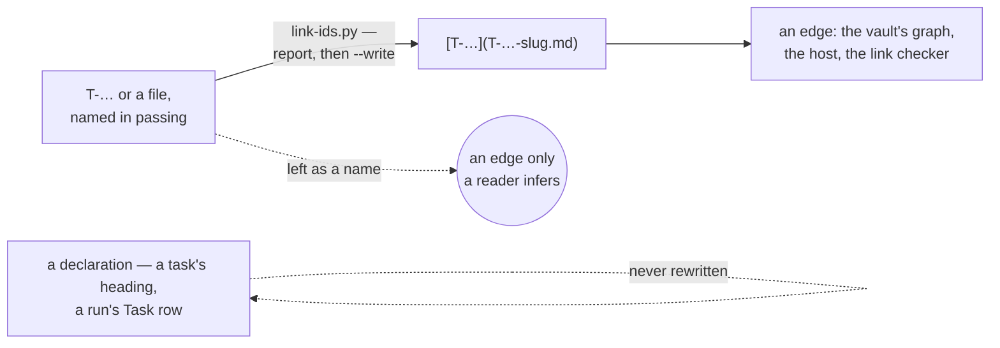

# Project layout — what this creates in your repository

**Load when:** standing a project up, joining one, or asking where something is supposed to live.

**Everything is a file, and the layout is the whole storage design.** There is no database and no
service: the directory structure *is* how the project is stored, which is why it is worth being
deliberate about.

---

## The tree

```
your-project/
  <your own files>      # code, content, whatever the craft makes — untouched
  CLAUDE.md             # the generated guide — the one file runtimes need at the root
  .claude/              # generated runtime wiring (agents) — fixed location
  .mcp.json             # the project's MCP servers, committed — secret NAMES, never values
  mise.toml             # the runtimes, tools and system packages it needs, pinned —
                        #   both native files, read by their own runtimes; each entry has
                        #   a row in _ops/TOOLING.md saying why (tooling.md)

  _ops/                 # everything the machinery owns, one door, first in any listing
    config.md           # adapter · conventions · spec_mode · the migration ledger
    ABOUT.md            # always-loaded: what this is, for whom, the vocabulary
    DECISIONS.md        # append-only decision record
    LATER.md            # deferred, each with a revisit moment
    BACKLOG.md          # the one hand-kept ordering surface
    BOARD.md            # generated: every task, its status, who has it, which release —
                        #   `scripts/board.py --write`, and `--check` says if it has drifted
    ROADMAP.md          # the sequence of intents, each with its why
    MAP.md              # the product as moves and things — each move naming its job
    MARKET.md           # how big the opportunity is: TAM · SAM · SOM, each figure
                        #   carrying its source and its date, or `unknown`
    ARCHITECTURE.md     # where the implementation lives
    BUDGET.md           # the envelope, stated as shares
    ECONOMICS.md        # what the product earns and costs
    COST.md             # generated: what the work has spent, rolled up from the run
                        #   records — `scripts/cost-report.py --write` (cost.md)
    TOOLING.md          # the register: every wired tool, its ceiling
    TEAM.md             # the roster — generated, never hand-kept
    FIELD-NOTES.md      # friction, recorded where it happens
    assets.md           # every asset in use: origin · what · source · licence · where
                        #   origin: drawn | stock | generated — the last carries a
                        #   recipe too, and a commit gate reads it (visual.md)

    tasks/              # flat; hierarchy is a field, not a folder
    specs/              # the spec rung's documents, unless a binding says otherwise
    roles/              # one file per role → .claude/agents/
    teams/              # members · routing rule · aggregation — from templates/GROUP-template.md
    panels/             # who answers when you ask the audience — the same template, kind: panel
    pipelines/          # stages · gates on transitions · starts
    requests/           # open asks, each with its age
    threads/            # correspondence with anyone outside the team — one file per
                        #   counterpart, verbatim, dated. Tasks link here and never re-quote
    releases/           # shipments — and beside them:
    milestones/         #   checkpoints, orthogonal to releases
    automations/        # trigger · template · contract
    resources/          # places to look, each with its why
    skills/             # the pool; attachment lives on the role
    templates/          # optional: a translated copy of a template. `TASK.md` here is read by
                        #   `new-task.py` and by the guard's §23 in place of the skill's, so a
                        #   project works in its own language without inventing its own shape
    scripts/            # installed: preflight.sh (from templates/company-preflight.sh) ·
                        #   transition.py · new-id.py (from the skill's scripts/) —
                        #   plus the project's own helpers, grown as you go
    runbooks/           # how to operate a wired thing, kept out of the guide
    research/           # one file per QUESTION, from templates/FINDING-template.md — what we
                        # now believe, what would change it, and the source ids under it. A topic
                        # never closes and a question does, so the file is named for the question.
      raw/              # transcripts, exports, screenshots — raw material, never a finding
    audience/           # segments, personas, their grounding
    design-system/      # tokens, components, their rules
    brand/              # voice, identity, what may not bend

> [!CAUTION]
> **Paths are ASCII; what is written inside them is the project's own language.** A name is
> transliterated — `T-MEY1HV-akt3-kuda-idyot.md` — and the document it names is written in
> Russian, Azerbaijani or whatever the project speaks. Measured on a live project: 126 tracked
> paths under `_ops/` carried Cyrillic, and git prints those as octal escapes in every `status`,
> every `log --name-only` and every diff header, so a maintainer reads
> `"_ops/tasks/T-MEY1HV-\320\260\320\272\321\2023-…"`. macOS stores names as NFD and Linux
> as NFC, so one file can fail to match itself across two machines. The guard refuses a new
> non-ASCII path under `_ops/`; nothing constrains the text.

    process/
      types/            # per kind of work: definition of done · pipeline
      labels.md         # the label taxonomy, with what each means
      gates.md          # named gates a pipeline may cite
      grants.md         # loosenings that expire by their own terms

    .index/             # derived caches — gitignored, rebuildable
    .checkout           # the live tree's holder — gitignored, read by arrival
```

---

## Rules the layout enforces

**Flat where identity matters.** Tasks and roles are flat because **hierarchy in a field means
re-parenting is a one-line edit** instead of a move that breaks every inbound link. Links point at
ids, so renames are safe.

**`_ops/` opens as a vault.** Relative links and diagrams, readable both on the host and in a local
editor. With the repository open in one, the generated board **is** a live board — with two
caveats worth stating: do not keep a generated file open in edit mode during a regeneration, and
query plugins refresh on their own cadence.

**An edge is a link, or the graph cannot see it.** A vault draws its graph from links alone, so an
id or a file named in passing — *blocked by T-…*, *see `_ops/DECISIONS.md`* — is an edge only a
reader infers. The templates write ids as links, `[T-XXXXXX](T-XXXXXX-slug.md)`; what was written
before is what the skill's `scripts/link-ids.py` reports, and its `--write` converts — the owner's
word, offered at an upgrade. **Declarations stay as written**: a task's heading and a run's
`**Task**` row are where an id is declared, and readers parse them; a History section and the run
records are kept as they were logged. Measured 2026-09-11 on a live project: 298 links in `_ops/`,
and 273 mentions in 171 files that could have been.



**Generated files carry markers and a header**, and only the generator writes between them —
board, roster, progress, children lists, changelog, analytics. **A view, never a source.**

**`.index/` is the boundary of "everything readable in markdown".** A cache is not a record: it is
derived, disposable, and losing it costs nothing. That is why it may be JSON and outside git while
everything else is not.

**`CLAUDE.md` is generated, not hand-written.** Its sources are `_ops/ABOUT.md`, `_ops/process/` and
the conventions. **Every worker loads it natively**, which is why a thousand tokens added to it is
a thousand tokens on every run of every role, forever.

**Roles are generated into the runtime's own agent directory.** The role file *is* the agent
definition — `model`, `effort`, `tools`, `skills`, `maxTurns`, `isolation`, `color` are its fields.
**Names must be unique across the whole tree**: a collision is resolved silently by filesystem
order, with no error.

**One repository is one project.** Several deliverables inside it are **areas** — a declared field.
Other repositories are **dependencies**: resources of kind `repo`, each with a `why` saying what
changes there require changes here.

---

## What is not here

**No user preferences.** Language, editor, which projects are in which session, favourites — these
live outside any project and **never in it**. A project must not become unopenable because someone
else's preferences are missing.

**No secrets.** Only a register of references: name, purpose, prefix, last used, expiry. Values
live in the environment or a keychain.

**No stored rollups.** Progress, burn and totals are computed from the atoms every time
([`PATTERNS.md`](PATTERNS.md) §4).

**Not every layer, necessarily.** Where a layer lives is a project decision, and `_ops/config.md`
carries **the manifest — one line per layer, naming its destination**. It stays in the repository
even when most layers do not, because a clone that gives contents without a map is worse than one
that gives a map without contents: the first looks complete → [`storing.md`](storing.md).

**The local store is not the source of truth.** `~/.opsinist/projects/<slug>/` holds a complete
copy so the graph resolves and a move needs no interrogation, but **which side is canonical is
declared per destination and does not move**. A copy is not an authority.

---

## Showing things inside a document

**Standard markdown, never a viewer's dialect.** An image is `` and a
link is `[text](relative/path.md)` — those render on the git host, in an editor, in a vault and on
a generated site. **Wiki-style `[[double brackets]]` render in one of those four**, and choosing
them makes the repository readable only inside the tool that was open when someone wrote it.

**A diagram is text, in a fenced ```mermaid block.** It diffs, it reviews, an agent can edit it,
and it draws itself almost everywhere a reader will open the file — **natively, no plugin, in the
three places threads actually get read**: the git host, Obsidian (built in since 0.15, in both
reading and live preview) and Notion (checked 2026-07-29). The measured exception is a generated
site, whose generator needs its own mermaid wiring — ours did. **A picture of a diagram is a
diagram nobody can change** — export one only when something must render where mermaid does not.

**What cannot be embedded gets a pointer and a still.** A design file, a video, a 4 GB render: the
thing lives where it is made, and the document carries **a link, a distillate, and an exported
frame or screenshot** so a reader on a plane still knows what is being discussed →
[`resources.md`](resources.md). The still is dated like any other snapshot.

**Paths are relative and inside the repository.** An absolute path is one machine's truth, and a
hotlinked remote image is a page that goes blank when somebody else's account lapses.

**What the graph needs, stated once, because the graph is the payoff for all of the above.** A vault
draws an edge when a *note* links a *note* by a path it can resolve from the file it is written in.
So four things, and the guard's §27 refuses the first three:

- **a relative path**, for the reason stated two paragraphs up;
- **a target that exists** — a dead link draws an edge into empty space, which is worse than a bare
  name because it reads as navigable;
- **no unencoded space** in a target (`%20`, or rename the file — our slugs are ASCII for this
  reason among others);
- **the vault opened at the project root, not at `_ops/`.** Both work for reading; only the first
  resolves a link from a task to `CLAUDE.md` or to a source file, because a link that climbs above
  the vault root is outside the graph. A project whose vault is `_ops/` gets a graph of the
  machinery with the product missing from it.

**A link to a script or a data file is an attachment, not a note** — `transition.py`, a PNG, a JSON
fixture — so those edges only appear with attachments switched on, and they are not what the graph
is for. **The edges worth having are between notes**: a task and its parent, a task and the role
holding it, a finding and the register entry it reads against, a run and the task it served.

**No plugin is required to read a project, and that is a constraint rather than an accident.** If
something genuinely needs one — a diagram format nothing else draws, a preview only one tool
renders — that is a tooling decision with a register entry and a `why`, not a quiet dependency
every future reader inherits → [`tooling.md`](tooling.md).

---

## Which template writes which artifact

**A template nobody is sent to is a file, not a template.** Each artifact below has one, and
using it is what keeps the same document recognisable across projects — an agent that invents the
shape each time produces a document only its author can read.

| Artifact | Template |
|---|---|
| the project guide | [`templates/GUIDE-template.md`](templates/GUIDE-template.md) |
| `_ops/config.md` | [`templates/CONFIG-template.md`](templates/CONFIG-template.md) |
| `_ops/FIELD-NOTES.md` | [`templates/FIELD-NOTES-template.md`](templates/FIELD-NOTES-template.md) |
| `_ops/MARKET.md` | [`templates/MARKET-template.md`](templates/MARKET-template.md) |
| `_ops/research/<question>.md` | [`templates/FINDING-template.md`](templates/FINDING-template.md) |
| `_ops/ARCHITECTURE.md` | [`templates/ARCHITECTURE-template.md`](templates/ARCHITECTURE-template.md) |
| `_ops/MAP.md` | [`templates/MAP-template.md`](templates/MAP-template.md) |
| `_ops/process/types/<type>.md` | [`templates/TYPE-template.md`](templates/TYPE-template.md) |
| `_ops/DECISIONS.md` | [`templates/DECISIONS-template.md`](templates/DECISIONS-template.md) |
| `_ops/ROADMAP.md` | [`templates/ROADMAP-template.md`](templates/ROADMAP-template.md) |
| **a task** → [`writing-work.md`](writing-work.md) | **[`templates/TASK-template.md`](templates/TASK-template.md)** |
| **a role** → [`hiring.md`](hiring.md) | **[`templates/ROLE-template.md`](templates/ROLE-template.md)** |
| **a run record** → [`dispatching.md`](dispatching.md), [`cost.md`](cost.md) | **[`templates/RUN-template.md`](templates/RUN-template.md)** |
| **a correspondence thread** — anyone outside the team | **[`templates/THREAD-template.md`](templates/THREAD-template.md)** |
| `_ops/TEAM.md` | [`templates/TEAM-template.md`](templates/TEAM-template.md) |
| `_ops/TOOLING.md` | [`templates/TOOLING-template.md`](templates/TOOLING-template.md) |
| `_ops/BUDGET.md` | [`templates/BUDGET-template.md`](templates/BUDGET-template.md) |
| a brand definition | [`templates/BRAND-template.md`](templates/BRAND-template.md) |
| a design-system component | [`templates/COMPONENT-template.md`](templates/COMPONENT-template.md) |
| a persona role → [`audience.md`](audience.md) | [`templates/PERSONA-template.md`](templates/PERSONA-template.md) |
| a discovery pass → [`process-discovery.md`](process-discovery.md) | [`templates/discovery-template.md`](templates/discovery-template.md) |
| a new skill → [`skills.md`](skills.md) | [`templates/SKILL-SCAFFOLD.md`](templates/SKILL-SCAFFOLD.md) |
| a change to this system → [`self-maintenance.md`](self-maintenance.md) | [`templates/SELF-MAINTENANCE-brief.md`](templates/SELF-MAINTENANCE-brief.md) |
| the project's own release gate → [`shipping.md`](shipping.md) | `templates/company-preflight.sh` |

**Where a template does not exist, the artifact does not get invented on the spot** — it gets one,
as a task, once the second project needs the same shape ([`PATTERNS.md`](PATTERNS.md) §22).

**The first three rows are new on `2026-07-31`, and their absence was the loudest silence in this
file.** Eleven artifacts a project writes occasionally each had a template; **the three it writes
constantly — a task, a role, a run — had none**, and their shape lived as field-definition tables
inside the chapters. A definition table says what a field *means*; **a template is a file you
copy, where the field you skipped leaves a hole somebody sees.** [`cost.md`](cost.md) had already named the
consequence without being able to prevent it: *a run recorded by the worker itself carries a
sentence where four numbers belong, which is how a ledger quietly becomes prose.*

**The last row is the only one that is not a document, and it is the one that must actually be
run.** Copied to `_ops/scripts/preflight.sh` and wired with `bash _ops/scripts/preflight.sh --install` —
**and the doors travel with it**: `transition.py` and `new-id.py` are copied beside it, because the
guard's own refusal names the door, and a refusal pointing at a file the project does not hold is
a dead end, measured on a live project. **All three are re-copied at every migration**, each from its own source — the guard from
`templates/company-preflight.sh`, the doors from the skill's `scripts/transition.py` and
`scripts/new-id.py`; the skill repo's own `scripts/preflight.sh` is the **corpus** guard and must
never land in a project — because a project running new rules with old gates is the same dead end
one release later ([`upgrading.md`](upgrading.md)). It
is what makes several of this system's rules real in this project — among them: a task cannot reach a terminal
status in the same commit that edits its own bar, an entitlement cannot be claimed with nothing
behind it, and the decisions log cannot be rewritten. **Un-wired, all three are `prose-only`
here** whatever [`permissions.md`](permissions.md) says in general — a gate that lives in an uninstalled file is a
gate nobody has. So it is wired when the project is stood up, and **whether it is wired is worth
one line in the guide**, because the next agent has no way to tell by looking.

---

## Starting small

**Not all of this appears on day one.** A new project gets `CLAUDE.md`, `_ops/config.md`, `_ops/tasks/`,
`_ops/roles/` with one advisor, `_ops/process/types/` and the parts of `_ops/` the interview actually named.

**The rest appears when something needs it** — the same rule as hiring. A directory created in
advance is a guess, and an empty one is a question every reader has to answer for themselves.
