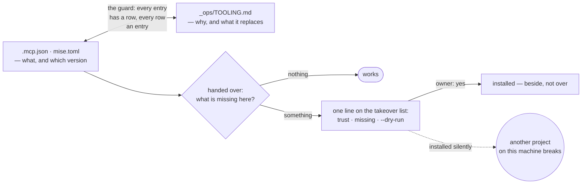
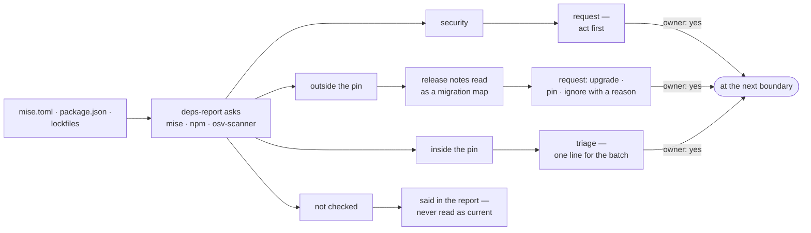
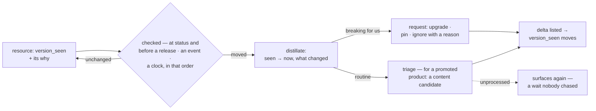

# Tooling — connecting things, and knowing what is connected

**Load when:** connecting a service, operating one, or asking what this project depends on.

---

## Connect-or-create

**Inventory first** — *"what already exists?"* — then per service: **exists → connect; missing →
create it, then connect**. Creating an account or a repository on the owner's behalf is an
outward action **on their account**, so it is confirmed out loud, **naming the account it would
land in**, and the visibility is stated as it is created.

**The shelf is the FIRST stop, and a web search is the second.** [`catalogue.md`](catalogue.md) is a shelf of
named answers per need, each carrying **a licensing or fallback decision somebody already paid
for** — which a search cannot return, because a search returns what is popular this month. So the
order is: **read the row · then search for what the row does not cover · then hand-wire**, and an
agent that starts at the search has already skipped the part that took a year to learn. The same
order holds for *references* as for tools — a look, a brand, a landing page: the galleries section
is where the moodboard comes from, and [`visual.md`](visual.md) is the craft that uses it. **Nothing in the
shelf is binding**: it is the first place to look, not the answer, and a row that is wrong for this
project is said so and passed.

**Check registries before hand-wiring.** An existing, maintained integration beats one you build,
and the maintained-and-popular signal is worth reading before choosing between three.

**Take what the service itself ships, before writing a line against its API.** Most services worth
connecting now publish some of: an **MCP server** (the project's `.mcp.json`), a **CLI** (`mise.toml`),
an **agent skill** (the pool, or a register row when the runtime provides it), an SDK, and a
documentation endpoint. Each one replaces code this project would otherwise own, and each one is a
**dependency the moment it is used**, so connecting is two acts in one breath: install what the
service ships, and declare it where its kind is declared → *What the project needs from the machine*
below, and [`skills.md`](skills.md) → *Where a skill comes from*. **Nothing is installed on the machine without the
owner's word** — the dry run first, the versions named, then the install. A connection that works
only because the person who made it already had the CLI is a connection the next clone does not
have, and it fails by doing less rather than by failing.

**A project's dependency goes in the project, and nothing of a project's lands in the machine.**
This is a one-flag discipline and the flag is not the default, which is the whole problem. Read in
Claude Code's own documentation, 2026-09-18:

| What | Where a project's copy lives | What reaches the user's machine |
|---|---|---|
| **an MCP server** | `.mcp.json` at the root, committed — `claude mcp add --scope project …` | **an approval record only**: whether this project's servers were trusted, plus a per-project `disabledMcpServers` toggle, both in `~/.claude.json`. `claude mcp reset-project-choices` clears it |
| **a skill** | `.claude/skills/<name>/SKILL.md`, committed — the pool in `_ops/skills/` is the source, this is the copy the runtime reads | nothing documented |
| **an agent** | `.claude/agents/<name>.md`, committed — markdown with `name` and `description`, no build step | nothing documented |

**`claude mcp add` defaults to `local`, and local means `~/.claude.json` keyed by the project's
path — which stays there after the directory is deleted.** That is the clutter to avoid, and
avoiding it costs six characters: `--scope project`. **So the rule is: a project's server is added
with `--scope project` or not at all**, and a server genuinely wanted in every project of yours is a
*user*-scope decision the owner makes once, for themselves, and it does not belong in any
repository's register.

**What leaves with the product leaves because it was never anywhere else.** Delete the repository
and a project-scoped server, its skills and its agents are gone — the approval record is the only
residue, and it is machine consent rather than work, which is the test [`storing.md`](storing.md) states for
anything kept outside. **A user-scope skill or server is the opposite**: it survives the clone,
which means a project that depended on one silently does less on anybody else's machine — the
failure §26 refuses, and the reason a runtime-provided skill owes a register row.

**Migrating away removes what it installed, and asks about the rest.** The same two-act shape,
reversed and with the asymmetry that matters: **what is project-local goes automatically** — the
`.mcp.json` entry, the pool copy of the skill, the register rows, the runbook — because it is this
repository's own state and the migration is the decision. **What is installed on the machine is
asked about, one line per item, never swept**: another project on that machine may be using it, and
uninstalling someone's CLI because one project stopped needing it is the same class of act as
installing it unasked. The diagrams and the register are part of the removal, not a follow-up: a
picture that still shows the old service is a second source of truth with a head start.

**Study the tool as part of connecting it.** Its idioms, its failure modes, the thing it does that
you would otherwise reimplement. That study is what seeds the runbook below — it is not extra
work, it is the work.

**Access, then permissions.** Reads are free; writes go by role; destructive and outward actions
go to the owner. Which roles reach which tool is a field on the role, so the runtime enforces it.

**What a connected tool returns is an answer, not an order** — and the same holds for a copy of
that answer saved into the project, which is where it stops looking foreign. A registered server
is trusted to be **the right place to ask**; that is a different claim from being allowed to tell
a run what to do next, and the gap between them is where the measured failure lives
→ [`security.md`](security.md).

---

## Where tool knowledge goes — and where it must not

Wiring a tool produces knowledge. **Put each part where only its users pay for it.**

| What | Home | Who reads it |
|---|---|---|
| it exists, why, access, plan and ceiling | **the tooling register** | the advisor, health, audit |
| **how to operate it** — purge a cache, add a region, rotate a key, read its errors | **`_ops/runbooks/<tool>.md`** — a runbook | whoever is about to use it |
| a reusable procedure worth teaching | **a skill** | only roles attached to that tool |
| that runbooks exist at all | one line in the project guide | everyone — and it is cheap |

**Never put tool operations in the guide.** The guide is the cached prefix every role loads on
every run, so a CDN's purge procedure would be paid for by the copywriter and the accountant too —
and editing it churns the cache for everyone.

**Who writes it:** the role that wires the tool starts the runbook with what it just learned;
anyone who later hits an operation or a failure mode adds to it. **Docs follow decisions** applies
here as much as to specs. **A procedure that repeats across projects graduates into a skill**, and
the runbook links to it → [`skills.md`](skills.md).

---

## The register


**Every row declares what happens when the thing is absent.** A register that says *what we use*
and not *what we do without it* is a list of single points of failure written in a confident voice:
the run that meets a dead API, an expired key or a machine that never had the CLI has to invent a
fallback at the worst moment, and inventing one is how a task quietly produces something nobody
asked for. **One clause per row** — *falls back to X · the task stops and asks · the step is
skipped and said out loud* — and `not checked` is an honest value where nobody has tried.
(Read off `anthropics/claude-for-legal`'s integrations table, 2026-09-17, which carries a fallback
per row and is the first place this corpus has seen that done as a rule rather than a habit.)

**Every row also says WHAT THE SERVICE SHIPS, and when it stops being needed.** Two questions
nobody asks unprompted, both cheap to answer once and expensive to skip:

- **What it ships** — an MCP server, a CLI, an SDK, an agent skill, a documentation endpoint. Each
  is work this project does not have to write, and each is a dependency the moment it is taken; the
  row records both what exists and which of it you took. **`checked <date> · none found` is a
  complete answer, and an empty cell is not** — an empty cell cannot be told apart from nobody
  having looked, which is exactly what happened on the measured project: a service was chosen and
  **nothing ever asked whether it had an API, a CLI or an MCP**, because there was no register to
  ask in (2026-09-16).
- **Gone when** — the observable condition that retires the row. *When the platform ships it · when
  the free tier stops covering us · when the feature it serves is cut.* **A dependency with no
  removal condition never leaves**, and the reason it arrived is not the reason it stays: *why it is
  here* is already refused blank by the guard on the commit that adds it, and this is the other end
  of the same sentence. Not *when we don't need it*, which is not a condition anybody can observe.

```mermaid
flowchart TD
  N["a service is chosen"] --> W{"what does it<br/>SHIP?"}
  W -->|"MCP · CLI · SDK · skill"| T["take it — work you<br/>do not have to write"]
  W -->|"nothing found"| D["`checked &lt;date&gt; · none found`<br/>— an answer, not a blank"]
  T --> R["a register row"]
  D --> R
  R --> G{"gone when?"}
  G -->|"an observable condition"| K["the row can retire itself"]
  G -.->|"blank"| F["it never leaves"]
  R -.->|"no register at all"| Q["nobody ever asks<br/>what it ships — measured"]
```

**It is the probe list for the health check, not documentation.** A tool missing from here is **a
tool nobody checks, whose token nobody rotates, and whose breaking change surprises the team**.

One row per tool: **what it is for · access and where the secret lives · how it is wired ·
checked**.

**Rules that keep it honest:**

- **Secrets are never written here** — only *where they live*.
- **"Checked" is a date, not a tick.** Versions, free-tier limits and prices all drift; **an entry
  past its recheck is unknown, not fine**, and the audit reads that column.
- **Self-hosted or managed matters** — it changes who is on the hook when it breaks.
- **A tool nobody has used in a quarter is a candidate for removal, not furniture.**

**And a section for what publishes a changelog or a release feed, and where.** The version check
reads exactly that: **a tool that changed its interface breaks agents silently**, the same way a
stale pin does.

---

## What the project needs from the machine

**A project that runs on one laptop and not the next is a project whose needs were never written
down**, and it is discovered on the worst day: the day it is handed to someone else. Three kinds of
need live outside the code, and **each has a native file that is the truth** — the register row
says *why*, the native file says *what and which version*, and the guard holds the two to each
other:

| The need | The native file — the truth | The register row says |
|---|---|---|
| an MCP server | `.mcp.json` at the root, committed | why · what it replaces · the **name** of any secret it reads |
| a runtime or CLI tool — python, node, a converter | `mise.toml`, `[tools]` | why · what it replaces |
| a system package — a library, an OS tool | `mise.toml`, `[bootstrap.packages]`, a line per OS | why · what it replaces |

**Never a second list.** The version lives in the native file and nowhere else — a register that
repeats it is two numbers that will disagree, and the older one will be the one somebody reads.
The row's *Wired how* cell names the file: `.mcp.json`, `mise.toml`.

**`.mcp.json` carries secret names, never values.** Measured on Claude Code 2.1.226: a server from
`.mcp.json` stays *pending approval* on each machine until someone approves it there, `${VAR}` in
its `env` expands from that machine's environment, and **a variable that is missing is a warning,
not a refusal — the server is started with the literal text `${VAR}`**. So a secret-shaped key
holding a literal is refused whatever the literal is: a leaked token and a placeholder like
`YOUR_API_KEY` fail the same way, and only the second one is harmless. What passes names the
secret and holds none — `${NAME}`, or `Bearer ${NAME}` in a header, the form the runtime's own
documentation writes — and never with a `:-default`, which is a value written into the file.

**mise isolates by project and leaves the machine alone** (read in mise's documentation,
2026-09-11). `[tools]` installs each version beside the others and puts it on `PATH` only inside
this project's directory, so the machine's own python stays what it was and a second project on a
second version is untouched. `[bootstrap.packages]` goes through the OS's own manager — `brew`,
`apt`, `winget` — and **accepts a version already installed**, so nothing is installed twice. The
honest cost is on the first half: a pinned runtime is mise's own copy even when the same version
exists through another route, because that copy is what the isolation is.

**Nothing is installed without the owner's word — mise included.** Taking a project over
([`entering.md`](entering.md)) already refuses to fix anything before the owner has seen the debt list, and what this
machine is missing is one more line on it: what `mise ls --missing` and `mise bootstrap packages
status --missing` report, what `mise install --dry-run` and `mise bootstrap packages apply
--dry-run` would change, and the owner's yes before anything runs. **A `mise.toml` carrying
`[bootstrap.packages]` is not read at all until it is trusted on that machine** — one with `[tools]`
alone is (measured on mise 2026.9.5, 2026-09-11) — so `mise trust` heads that line, and it is the
owner's to say, since a trusted file can install system packages. **A project that changes
versions on a machine by itself breaks the other projects that machine carries**, and nobody would
think to look here.

**Found undeclared, it is declared.** A binary the scripts call or a runtime version the code
assumes, with no entry anywhere, is the next laptop's failure waiting: the fix changes the project
and not the machine — an entry pinned at the version this machine already runs, since that is the
one the code was last seen working on, and its row.



---

## When something it needs has a newer version

**An update is a fact the tools already know and a decision only the owner can make**, and the two
fail in opposite directions: an agent that upgrades by itself changes the machine under every
other project on it, and one that never looks lets a published vulnerability ride. The skill's
`scripts/deps-report.py`, run from the project's root, asks the tools that know — `mise outdated`
for what `mise.toml` pins, `npm outdated` where `package-lock.json` is the lockfile, `osv-scanner`
over every lockfile — and sorts each answer by what it asks of the owner:

| What it found | What it asks | Where it goes |
|---|---|---|
| **security** — a published vulnerability in something the project ships | act first | a request, carrying the advisory ids |
| **outside the pin** — newer than the version the project pinned | a decision, with the release notes as its map | a request: upgrade · pin · ignore with a reason |
| **inside the pin** — a newer build of what was already chosen | routine | triage, one line for the batch |
| **missing** — declared, not installed on this machine | the owner's word | the takeover list, as in *What the project needs from the machine* |
| **not checked** — the tool that would know is absent, offline, or answered in a shape it does not read | nothing, but it is said | the report itself: silence would read as *current* |

**The line between routine and decision is the project's own pin, not the version's numbering.**
Python 3.12 → 3.13 is a minor number, and 3.13 removed nineteen standard-library modules outright
(PEP 594, *What's New in Python 3.13*, read 2026-09-11); what the project wrote in `mise.toml` or
`package.json` is its only statement of what it agreed to. npm draws the same line in its own
output — `wanted` inside the range, *update now*; `latest` beyond it, *proceed with caution* (npm's
`outdated` documentation, read 2026-09-11).

**A decision carries its migration map.** For an update outside the pin, read the release notes
between the two versions — the report prints the link where the tool publishes one — and list what
they touch here, the same delta a moved resource opens (*Dependencies — other repositories*): each
mismatch a task, or an explicit *"still true, checked"*.

**The report reads and never writes** — no install, no upgrade, not even `mise trust` — and exits 0
whatever it found, because the gate on what is declared is the guard. It needs the network, so it
runs with the health checks ([`checking.md`](checking.md) → *Health*: on arriving, before a release, when something
feels wrong) rather than riding `status` the way a resource's tag comparison does. An accepted
update lands at the next boundary, never under work in progress ([`upgrading.md`](upgrading.md) → *When it
applies*).

**`--why` answers the other question — what is this for?** — from the project's own files, offline:
every entry in `mise.toml`, `.mcp.json` and the package manifests, beside its register row, or the
`_ops/DECISIONS.md` line that names it (the line the guard's §4e asks for when a dependency is
added), or *no why recorded*. A view, never a second list: nothing in it is kept by hand, so
nothing in it can drift.



---

## Dependencies — other repositories

A repository this project depends on is **a resource of kind `repo`**, not a project. It carries
the mandatory `why` in a specific form: **what it is, and what changes there require changes
here.**

That is what removes the pain of "wiring repositories together": the relationship becomes
**written and checkable** rather than remembered.

**Watching is derived from the kind, not asked about.** Declaring something a dependency is
already a statement that changes there matter here, so **a `repo` resource is watched by default**
and a plain reference is not. Asking the owner which things to watch is a question with no good
default, at a moment when they do not yet know the answer.

**Three tiers, and start at the cheapest:**

1. **Ride the sweeps you already run.** The version check runs at status and before a release; the
   link check runs at audit and before a release. Comparing a tag or a head is the same shape and
   costs one call. **No automation needed.**
2. **An event**, where lag actually costs — a push or a pull request on the same host.
3. **A clock**, only when the thing is external, has no event to subscribe to, and being late is
   expensive. Polling hourly burns runs and manufactures noise.

**What surfaces matters more than the mechanism.** *"It moved to 2.4"* is noise. The pointer holds
`version_seen` **and a distillate**, so the comparison reads *"you are on 2.1, they are on 2.4,
and here is what changed"* — and the resource's `why` answers whether that matters here.

**The shape of the surfacing limits the noise by itself:** a **breaking** change is a **request**
(upgrade · pin · ignore with a reason); a routine release **lands in triage** — where it takes a
disposition and, unprocessed, surfaces again like any intake. It used to be a notification that
ages out, and that was reversed deliberately: a release nobody processed is exactly a wait
nobody chased, and fading is what this file's own delta rule now refuses.

**A watch with no owner is noise waiting to happen.** The automation contract requires a named
owner for failures; if nobody owns the integration, it should not be watched.



**And the owner may ask instead of waiting for a sweep** — *"did anything we watch move?"*,
*"check the resources"* — the same check, run now, with *unchanged* said per row rather than
implied by silence.

**Accepting the move opens the delta, so mismatched pieces cannot linger unlisted.** The
distillate is read as a migration map — the same discipline upgrades use — against **the
places that cite this resource** (`cited-by` on the resource, generated per §5 — **or, where no
generator has run, a search for its name and targets, said as a search**): a post
quoting the old API, a vs-page carrying the old price, a config pinning the old flag. **Each
mismatch becomes its own line — a task, or an explicit "still true, checked"** — and the sweep
records what it walked, so a later empty pass reads as *quiet* rather than *nobody looked*.
`version_seen` moves when the delta is listed, not when the release was merely noticed.

**The campaign's product, living in another repository, is this same shape pointed the other
way** — *promoted* stays reserved for §23's climb, so the noun here is the campaign's product.
A campaign project for an open-source library does not vendor it, submodule it, or copy
its tree — **the library is a watched resource**: a pointer with a `why`, `version_seen`, and a
watch on its releases, whose distillate lands in triage as **content candidates** — a release
note is a post the campaign has not written yet. The inventory maps the product's tree
read-only when content needs the shape of it ([`entering.md`](entering.md)), nothing of the campaign's lands
in the product's repository unless it is also yours — and where it is yours, the two stay two
projects: one ships the product, one ships the campaign, and the watch is the whole coupling.

---

## When the tool is weak on its own

Some tools have poor or no support for being driven by an agent. **The team assembles the tooling
once rather than improvising in every task.**

**An agent may ask for a tool it does not have, and should.** *"This needs a transcription
service; the free tier stops at 30 minutes a month and this batch is four hours"* is a request
like any other — it carries the need, the candidate, the ceiling and what it costs, and it waits.
**Signing up, entering a card and holding a key are the owner's** — spend and credentials are
both gated, and neither becomes the agent's because the work would go faster.

**What the agent does instead of waiting idle:** name the free path if one exists and say what it
costs in quality or time, so the answer is a comparison rather than a demand.

**Find it:** official documentation first · registries and curated lists · **and ask the owner
where the documentation trail is ambiguous** — it is their tool, and inside their own expertise
they are a **live source**, which outranks a document.

**Save it in the project:** the assembled pack — documentation links, workflows that were verified
to work, snippets, and the traps — so the next task starts from a structure rather than from
nothing. That is the runbook.

**If the need is not one-off, it becomes its own task and the original waits on it** — a `tooling`
task in the system stream, with the original taking a `blocked_by`. And unblocking does not start
the original: it surfaces as ready → [`self-maintenance.md`](self-maintenance.md).

**Inline or a task?** The same threshold as everywhere: **twice**. Once is part of this job; twice
is a pattern that deserves its own.

---

## Before building anything, ask whether it already exists

**The first question for any new capability is not *how do we build it* but *does the platform
already have it — and is it on the shelf* ([`catalogue.md`](catalogue.md)).** Check the documentation and the tool's own help **before** designing, and
**record the answer** — a minute spent asking costs nothing, and missing it costs a home-grown
mechanism that drifts from the platform and confuses anyone reading both.

**The same rule applies when it genuinely does not exist**: say so explicitly, and **note the
version checked**, so a later reader knows the wheel was deliberate.

This is the rule this project has most recently been in danger of breaking, having rebuilt itself
on a runtime that turned out to already provide isolation, tool restriction, turn caps,
inter-agent messaging and scheduling.
